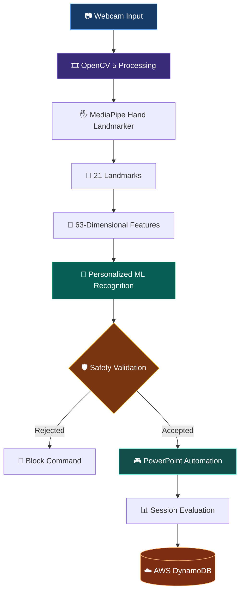

# 🖐️ GesturePilot AI
### AI-Based Hand Gesture Recognition & Intelligent Presentation Automation System

<p align="center">
  
</p>

<p align="center">
  <strong>Turn natural hand movements into intelligent, hands-free presentation control.</strong>
  <br>
  Real-time computer vision · Machine learning · Safety-first automation · AWS cloud analytics
</p>

<p align="center">
  
  
  
  
  
</p>

<p align="center">
  <a href="#-overview">Overview</a> ·
  <a href="#-gesture-playbook">Gestures</a> ·
  <a href="#-system-architecture">Architecture</a> ·
  <a href="#-evaluation-highlights">Evaluation</a> ·
  <a href="#-getting-started">Getting Started</a>
</p>

---

## ✨ Overview

**GesturePilot AI** is a real-time computer-vision application that transforms hand gestures into Microsoft PowerPoint commands. It combines OpenCV 5 video processing, MediaPipe hand landmark detection, personalized machine-learning recognition, temporal validation, and Windows PowerPoint automation.

The goal is simple: let presenters navigate slides naturally without repeatedly reaching for a keyboard, mouse, or physical presentation remote.

### 💎 What makes it different?

| Capability | What it does |
|---|---|
| 👁️ Real-time vision | Processes webcam frames using OpenCV 5 |
| 🖐️ Hand intelligence | Extracts 21 hand landmarks with MediaPipe |
| 🧠 Personalized recognition | Uses gesture features and live calibration |
| 🛡️ Safety-first control | Validates confidence, stability, neutral state, and cooldown |
| 🎬 PowerPoint automation | Converts accepted gestures into slide commands |
| ☁️ Cloud analytics | Stores session evaluation records in AWS DynamoDB |
| 📊 Measurable evaluation | Includes recognition, performance, safety, and robustness evidence |

---

## 🖐️ Gesture Playbook

Three distinct gestures control the presentation.

| Gesture | Command | Presentation action |
|:---:|---|---|
| ☝️ **ONE** | `PREVIOUS` | Move to the previous slide |
| ✌️ **TWO** | `NEXT` | Move to the next slide |
| 🤟 **THREE** | `START / EXIT` | Start or exit the slideshow |

<p align="center">
  <strong>☝️ PREVIOUS</strong>
  &nbsp; ← &nbsp;
  <strong>✌️ NEXT</strong>
  &nbsp; → &nbsp;
  <strong>🤟 START / EXIT</strong>
</p>

> **Interaction principle:** A detected hand pose is not automatically a command. The safety engine validates the gesture before presentation automation is allowed.

---

## 🎨 Inside the System

### 01 — Main System Architecture

<p align="center">
  
</p>

### 02 — Gesture Recognition & Safety Workflow

<p align="center">
  
</p>

### 03 — AWS Cloud Architecture

<p align="center">
  
</p>

### 04 — Evaluation Results Dashboard

<p align="center">
  
</p>

---

## ⚙️ System Architecture



### 🔬 The processing pipeline

1. **Capture:** Read frames from the webcam.
2. **Detect:** Identify the hand and extract its 21 landmarks.
3. **Represent:** Convert landmark coordinates into 63 numerical features.
4. **Recognize:** Classify the gesture using the personalized recognition pipeline.
5. **Validate:** Apply confidence, temporal stability, neutral-unlock, re-arm, edge-trigger, and cooldown rules.
6. **Execute:** Issue an accepted presentation command through PowerPoint automation.
7. **Evaluate:** Measure system behavior and record applicable session analytics.

---

## 🛡️ Safety Engineering

A reliable gesture interface must prevent unintended actions, not merely recognize hand poses.

| Safety mechanism | Purpose |
|---|---|
| Confidence and margin filters | Reject uncertain predictions |
| Temporal stability | Require consistent recognition |
| Neutral unlock | Require a neutral state before another command cycle |
| Re-arm logic | Prevent repeated firing from a held gesture |
| THREE edge trigger | Prevent continuous start/exit activation |
| Cooldown | Limit commands occurring too close together |
| Boundary protection | Prevent invalid previous/next slide actions |
| False-trigger prevention | Block commands that do not pass validation |

Rejected commands are an intentional part of the safety design. A blocked command is not automatically a system failure; it must be interpreted in the context of the safety rules and application state.

---

## 📊 Evaluation Highlights

The project includes controlled live-calibration tests, real-time performance measurements, domain-shift analysis, adaptation experiments, safety checks, and PowerPoint integration tests.

### Recognition results

| Gesture | Correct recognitions | Result |
|---|---:|---:|
| ONE | 10 / 10 | 100% |
| TWO | 10 / 10 | 100% |
| THREE | 11 / 13 | 84.62% |
| **Overall** | **31 / 33** | **93.94%** |

> **Evaluation qualification:** The 93.94% result is from a controlled live-calibration evaluation. It is not a claim of universal accuracy or performance on unseen users and environments.

### Runtime and robustness

| Metric | Observed result |
|---|---:|
| Frames processed in the recorded integration run | 4,593 |
| Frames with a detected hand | 2,228 |
| Hand visibility across processed frames | 48.51% |
| Average processing rate | 26.36 FPS |
| Successful commands recorded | 23 |
| Blocked or failed command attempts | 18 |

The recorded run included command attempts after the slideshow had exited; those actions were safely rejected. Successful commands and blocked attempts should therefore be interpreted separately.

### Domain adaptation experiment

| Configuration | Observed recognition result |
|---|---:|
| Original centroids | 34% |
| Mixed 50/50 adaptation | 49.33% |
| Pure live adaptation | 82% |

Pure live adaptation improved the measured result by **15.33 percentage points** compared with mixed adaptation in this experiment. These are experiment-specific results, not a guarantee of performance across users or sessions.

### Validation coverage

- ✅ PowerPoint previous-slide, next-slide, start, and exit integration checks
- ✅ Confidence and temporal stability checks
- ✅ Neutral unlock, re-arm, edge-trigger, and cooldown checks
- ✅ Boundary protection and false-trigger prevention checks
- ✅ Robustness and domain-shift evaluation
- ✅ AWS DynamoDB evaluation-record verification

Detailed evidence is maintained in the `evaluation/` directory, including the final evaluation script, result summaries, CSV metrics, and robustness report.

---

## ☁️ AWS Integration

**AWS DynamoDB** provides cloud-based session analytics storage.

| Setting | Configuration |
|---|---|
| AWS service | Amazon DynamoDB |
| Table | `GestureSessionAnalytics` |
| Region | `ap-southeast-2` |
| Capacity mode | On-demand |

A real evaluation record was written to and verified from DynamoDB. AWS credentials are maintained outside the source repository and must not be committed.

The cloud component supports evaluation and session analytics; it is not required to claim that the core gesture-recognition pipeline itself runs in the cloud.

---

## 🧰 Technology Stack

<p align="center">
  
  
  
  
  
  
</p>

- **Language:** Python
- **Computer vision:** OpenCV 5.0.0
- **Hand tracking:** MediaPipe Hand Landmarker
- **Machine learning:** scikit-learn and personalized gesture recognition
- **Desktop integration:** Microsoft PowerPoint COM automation through `pywin32`
- **Cloud analytics:** Amazon DynamoDB using `boto3`
- **Evaluation:** Python test scripts, CSV reports, and robustness analysis

Pinned dependency versions are provided in `requirements.txt`.

---

## 🚀 Getting Started

### Prerequisites

- Windows with a working webcam
- Python compatible with the pinned dependencies
- Microsoft PowerPoint desktop installed for COM-based presentation automation
- AWS credentials configured outside the repository if cloud analytics are to be exercised
- The required MediaPipe hand-landmarker model and other project assets

### 1. Clone the repository

```powershell
git clone https://github.com/snehassneha4578-collab/AI-Hand-Gesture-Presentation-Automation.git
Set-Location AI-Hand-Gesture-Presentation-Automation
```

### 2. Install dependencies

```powershell
python -m pip install -r requirements.txt
```

### 3. Configure required assets

Verify that the hand-landmarker model and any required local configuration are available. Configure AWS credentials securely through the supported AWS credential mechanism if running cloud analytics.

### 4. Run and evaluate

Use the project's primary controller/UI entry point for the live application. To run the packaged evaluation suite, use:

```powershell
python evaluation/final_evaluation.py
```

Check the evaluation outputs and application logs for the observed results. The evaluation script is distinct from the live presentation controller.

> **Compatibility note:** The dependency file pins specific versions. Use an environment compatible with those versions, and follow the project's model-asset and Windows PowerPoint requirements.

---

## 📁 Project Documentation

```text
AI-Hand-Gesture-Presentation-Automation/
├── docs/
│   └── images/
│       ├── Main System Architecture.jpg
│       ├── Gesture Recognition & Safety Workflow.jpg
│       ├── AWS Cloud Architecture.jpg
│       └── Evaluation Results Dashboard.jpg
├── evaluation/
│   ├── final_evaluation.py
│   ├── FINAL_EVALUATION_RESULTS.txt
│   ├── gesture_accuracy_results.csv
│   ├── system_performance.csv
│   ├── safety_results.csv
│   ├── robustness_results.csv
│   └── ROBUSTNESS_EVALUATION_REPORT.txt
├── requirements.txt
└── README.md
```

*This is a documentation-oriented overview of key files; the repository contains additional implementation modules, local configuration, and test assets.*

---

## ⚠️ Limitations & Responsible Use

- Recognition performance can vary with camera placement, lighting, hand position, and user-specific movement.
- The headline accuracy comes from controlled live calibration and must not be interpreted as an unseen-user benchmark.
- Live adaptation results are experiment-specific and may not generalize across sessions.
- Hand visibility is not guaranteed in every webcam frame.
- PowerPoint automation depends on application state; invalid commands should be rejected rather than forced.
- AWS analytics require valid configuration and permissions.
- Webcam use should be transparent and consent-based. Avoid storing or sharing unnecessary personal imagery.

---

## 🔮 Future Enhancements

- 🎞️ An embedded animated gesture demonstration
- 📈 Expanded evaluation across unseen users and recording conditions
- 🧪 Repeatable cross-session and cross-environment robustness tests
- 📊 Richer visual analytics for recognition, latency, and rejected commands
- ♿ Improved accessibility and calibration feedback

---

## 🏁 Project Status

**Implementation complete — evaluation evidence available.**

The system integrates OpenCV 5 video processing, hand-landmark extraction, personalized recognition, safety-gated presentation control, PowerPoint automation, and AWS DynamoDB session analytics.

Competition submission tasks such as final packaging, the short demonstration video, and the submission form are separate from implementation completion.

---

<p align="center">
  <strong>🖐️ See the gesture. 🧠 Validate the intent. 🎬 Control the presentation.</strong>
  <br>
  <sub>Built with computer vision, machine learning, safety engineering, and cloud analytics.</sub>
</p>
