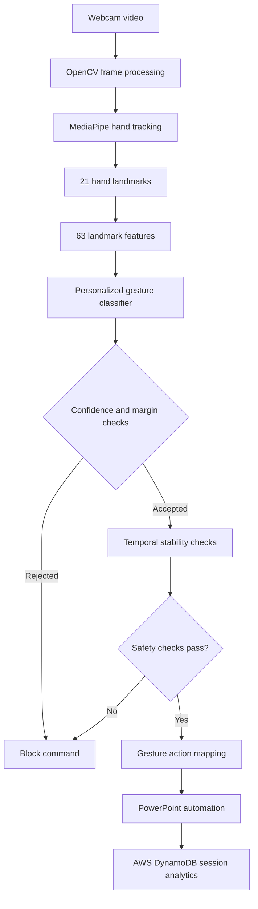

# 🖐️ GesturePilot AI
### Intelligent Hand Gesture Recognition & Presentation Automation

<p align="center">
  
  
  
  
</p>

<p align="center">
  <b>Control Microsoft PowerPoint with hand gestures — no physical clicker required.</b>
  <br/>
  Real-time computer vision, personalized gesture recognition, safety-aware command processing, and cloud-based session analytics.
</p>

<p align="center">
  <a href="#-project-overview">Overview</a> •
  <a href="#-live-system-preview">Preview</a> •
  <a href="#-gesture-controls">Gestures</a> •
  <a href="#-system-architecture">Architecture</a> •
  <a href="#-evaluation-results">Evaluation</a> •
  <a href="#-installation">Installation</a>
</p>

---

## ✨ Project Overview

**GesturePilot AI** is a computer-vision-based presentation automation system that recognizes predefined hand gestures through a webcam and translates them into PowerPoint commands.

The system combines OpenCV video processing, MediaPipe hand landmarks, personalized machine-learning recognition, temporal stability checks, command-safety controls, Windows PowerPoint automation, and AWS DynamoDB session analytics.

Instead of treating every frame as a command, GesturePilot AI checks whether a gesture is sufficiently reliable and stable before allowing an action. This helps prevent accidental slide changes and repeated commands.

### What makes it different?

- 🖐️ **Real-time hand tracking:** Uses 21 hand landmarks to represent hand position and structure.
- 🧠 **Personalized recognition:** Uses machine-learning-based gesture recognition with 63 landmark coordinates/features.
- 🛡️ **Safety-aware interaction:** Applies confidence and margin filtering, temporal stability, neutral unlock, re-arming, cooldowns, and edge-trigger protection.
- 🎬 **PowerPoint automation:** Supports previous slide, next slide, and slideshow start/exit commands.
- ☁️ **AWS integration:** Stores session analytics in Amazon DynamoDB.
- 📊 **Measured evaluation:** Includes gesture, performance, robustness, and safety evaluation artifacts.

## 🎥 Live System Preview

The following four images are the project's existing documentation assets. They are placed in the relevant sections below so readers can understand the system before exploring its implementation.

## 🏗️ System Architecture

<p align="center">
  
</p>

<p align="center"><i>Figure 1 — Main system architecture</i></p>

The system follows a processing pipeline:

1. Capture webcam frames.
2. Detect and track hand landmarks.
3. Extract the gesture feature representation.
4. Predict the gesture and evaluate confidence.
5. Apply stability and safety checks.
6. Execute the permitted PowerPoint command.
7. Record applicable session analytics in AWS DynamoDB.

---

## 🖐️ Gesture Controls

GesturePilot AI uses three configured gesture classes for presentation control.

| Gesture | PowerPoint action | Safety behavior |
|---|---|---|
| ☝️ **ONE** | Previous slide | Must satisfy recognition and stability checks |
| ✌️ **TWO** | Next slide | Must satisfy recognition and stability checks |
| 🤟 **THREE** | Start or exit slideshow | Uses edge-trigger protection to reduce repeated actions |

**Important:** THREE is configured for slideshow start/exit; it is not a pause/resume command. Four-finger and five-finger poses are not documented as configured presentation commands in this version.

### Gesture recognition and safety workflow

<p align="center">
  
</p>

<p align="center"><i>Figure 2 — Gesture recognition, validation, and command-safety workflow</i></p>

### Visual states: what the camera interface should communicate

The camera view should make system status easy to understand at a glance.

<table>
  <tr>
    <td width="50%" align="center">

### 🟢 HAND DETECTED

**Status:** Tracking active

A visible hand is detected and its landmarks can be processed.

`Detection active`

  </td>
  <td width="50%" align="center">

### 🔴 NO HAND DETECTED

**Status:** Waiting for input

No usable hand is detected in the current frame. No new gesture command should be issued.

`Waiting for hand`

  </td>
  </tr>
  <tr>
    <td width="50%" align="center">

### 🔵 GESTURE RECOGNIZED

**Status:** Candidate gesture

The classifier proposes ONE, TWO, or THREE. Safety checks must still pass before execution.

`Validation required`

  </td>
  <td width="50%" align="center">

### 🟠 COMMAND BLOCKED

**Status:** Action rejected

An uncertain, unstable, repeated, or otherwise unsafe command is prevented from executing.

`Safety filter active`

  </td>
  </tr>
</table>

These are **documented interface-state concepts**, not screenshots of the running camera application. Actual camera screenshots and landmark overlays should be added only when captured from the real implementation.

---

## 🧪 Gesture Samples: 2, 3, 4, and 5 Fingers

The sample gallery below distinguishes supported commands from poses that must not be assumed to have a configured action.

<table>
  <tr>
    <td width="50%" align="center">

**Sample 2 — Two fingers**


**Configured class:** TWO  
**Intended action:** Next slide

    </td>
    <td width="50%" align="center">

**Sample 3 — Three fingers**


**Configured class:** THREE  
**Intended action:** Start/exit slideshow

    </td>
  </tr>
  <tr>
    <td width="50%" align="center">

**Sample 4 — Four fingers**


**Status:** Not a configured command  
The system should not assign an action without an explicit mapping.

    </td>
    <td width="50%" align="center">

**Sample 5 — Five fingers**


**Status:** Not a configured command  
An open palm must not be assumed to trigger a presentation action.

    </td>
  </tr>
</table>

> **Image asset note:** The four sample image paths above are planned asset locations. The images are not included in the repository merely because their paths appear in this README. Add the actual image files before expecting these four slots to render on GitHub.

---

## 🛡️ Safety by Design

Gesture recognition alone is not sufficient for reliable presentation control. A prediction should not automatically become a command.

GesturePilot AI includes safety mechanisms that were tested during project evaluation:

- **Confidence filtering:** Rejects predictions that do not meet the configured confidence requirement.
- **Prediction-margin filtering:** Helps reject ambiguous classifications.
- **Temporal stability:** Requires a gesture to remain sufficiently consistent before action.
- **Neutral unlock:** Requires a neutral state before another gesture can be accepted where configured.
- **Re-arming:** Helps prevent a held gesture from repeatedly issuing commands.
- **THREE edge trigger:** Helps prevent repeated slideshow actions from one continuous gesture.
- **Cooldown:** Reduces rapid repeated commands.
- **Boundary protection:** Rejects invalid actions at presentation boundaries.
- **False-trigger prevention:** Helps block unintended commands.

These safeguards reduce accidental activation but do not guarantee zero false positives in every environment.

---

## 📊 Evaluation Results

The following results come from the project's recorded experiments. They should be interpreted within their specific test conditions, not as universal accuracy guarantees.

### Controlled live-calibration test

| Gesture | Correct detections | Test total |
|---|---:|---:|
| ONE | 10 | 10 |
| TWO | 10 | 10 |
| THREE | 11 | 13 |
| **Overall** | **31** | **33** |

**Observed controlled live-calibration result: 93.94% (31/33).**

This is a small controlled evaluation, not a claim of 93.94% accuracy for all users, cameras, lighting conditions, or unseen environments.

### Real-time integration run

| Metric | Recorded result |
|---|---:|
| Frames processed | 4,593 |
| Frames with a detected hand | 2,228 |
| Hand-frame proportion | 48.51% |
| Processing rate | 26.36 FPS |
| Successful commands | 23 |
| Blocked or failed command attempts | 18 |

Some rejected actions occurred after the slideshow had exited. These rejections are part of the observed integration run and should not be interpreted as 18 successful actions.

### Domain shift and adaptation experiment

| Experiment condition | Recorded result |
|---|---:|
| Original centroids | 34% |
| Mixed adaptation, 50/50 | 49.33% |
| Pure live adaptation | 82% |

The pure-live condition improved the recorded result by **15.33 percentage points** compared with the 50/50 mixed condition in this experiment. These results are experiment-specific and do not establish generalization to all users.

Additional recorded domain-shift observations:

- Mean feature shift: **1.2486 standard deviations**
- Features exceeding 2 SD: **8 of 45**
- Features exceeding 3 SD: **2 of 45**

### Evaluation visual

<p align="center">
  
</p>

<p align="center"><i>Figure 3 — Evaluation results dashboard</i></p>

### Evaluation artifacts

The `evaluation/` directory contains the project's evaluation scripts and recorded outputs:

- `final_evaluation.py`
- `FINAL_EVALUATION_RESULTS.txt`
- `gesture_accuracy_results.csv`
- `system_performance.csv`
- `safety_results.csv`
- `robustness_results.csv`
- `ROBUSTNESS_EVALUATION_REPORT.txt`

These files support inspection of the recorded measurements and the tests performed.

---

## ☁️ AWS Cloud Integration

<p align="center">
  
</p>

<p align="center"><i>Figure 4 — AWS cloud architecture</i></p>

GesturePilot AI integrates **Amazon DynamoDB** for session analytics.

| Component | Role |
|---|---|
| Amazon DynamoDB | Stores session analytics records |
| Table | `GestureSessionAnalytics` |
| Region | `ap-southeast-2` |
| Capacity mode | On-demand |

A live DynamoDB record was verified during implementation. This project uses DynamoDB for analytics; it does not claim to use AWS Lambda.

---

## 🧠 How the System Works



The diagram represents the high-level processing flow. Individual runtime behavior depends on the implemented classifier, configuration, and safety logic.

---

## 🧰 Technology Stack

| Technology | Purpose |
|---|---|
| Python | Main application and integration logic |
| OpenCV 5 | Webcam capture and video processing |
| MediaPipe Hand Landmarker | Hand landmark detection |
| NumPy | Numerical feature processing |
| pandas | Evaluation data and tabular outputs |
| scikit-learn | Machine-learning gesture recognition |
| pywin32 | Windows and PowerPoint COM automation |
| boto3 | AWS SDK integration |
| Amazon DynamoDB | Session analytics storage |

---

## 📁 Project Structure

```text
AI_Hand_Gesture_Presentation/
├── evaluation/
│   ├── final_evaluation.py
│   ├── FINAL_EVALUATION_RESULTS.txt
│   ├── gesture_accuracy_results.csv
│   ├── system_performance.csv
│   ├── safety_results.csv
│   ├── robustness_results.csv
│   └── ROBUSTNESS_EVALUATION_REPORT.txt
├── docs/
│   └── images/
│       ├── Main System Architecture.jpg
│       ├── Gesture Recognition & Safety Workflow.jpg
│       ├── AWS Cloud Architecture.jpg
│       ├── Evaluation Results Dashboard.jpg
│       ├── gesture-recognition-states.png
│       ├── gesture-sample-2.png
│       ├── gesture-sample-3.png
│       ├── gesture-sample-4.png
│       └── gesture-sample-5.png
├── requirements.txt
└── README.md
```

The tree highlights the main documentation and evaluation assets. Other application modules and data files are omitted from this abbreviated view.

---

## ⚙️ Installation

### Prerequisites

- Windows
- Python compatible with the pinned project dependencies
- A working webcam
- Microsoft PowerPoint desktop installed for COM-based automation
- AWS credentials configured if using cloud analytics

### 1. Clone the repository

```powershell
git clone https://github.com/snehassneha4578-collab/AI-Hand-Gesture-Presentation-Automation.git
Set-Location AI-Hand-Gesture-Presentation-Automation
```

### 2. Create and activate a virtual environment

```powershell
py -m venv .venv
.\.venv\Scripts\Activate.ps1
```

### 3. Install dependencies

```powershell
python -m pip install --upgrade pip
python -m pip install -r requirements.txt
```

The project uses pinned dependencies to improve reproducibility. Package availability can vary by Python version and platform, so use a compatible environment if installation fails.

### 4. Configure AWS credentials

If enabling DynamoDB analytics, configure credentials using an approved AWS credential provider, such as the AWS CLI profile or environment-based credentials. Do not place AWS access keys directly in source code or commit them to GitHub.

Confirm that the configured identity has only the permissions required by the application.

### 5. Run the application

Run the project's actual entry-point script from the repository root. Check the available application files or project instructions to confirm the correct entry point before launching.

---

## 🧪 Testing and Validation

The project includes checks covering:

- PowerPoint previous-slide, next-slide, and slideshow start/exit automation
- Gesture stability and confidence filtering
- Neutral unlock and re-arming
- THREE edge-trigger behavior
- Cooldown and presentation boundary protection
- False-trigger prevention
- Recorded accuracy, performance, and robustness evaluation

Refer to the evaluation artifacts for the recorded outcomes. A successful controlled test does not guarantee identical behavior on every machine or with every user.

---

## ⚠️ Limitations and Responsible Use

- Recognition depends on camera position, lighting, hand visibility, and the user's gesture execution.
- Controlled live-calibration results are not a substitute for larger unseen-user evaluations.
- The four-finger and five-finger samples are not configured commands in the documented mapping.
- PowerPoint automation depends on a compatible Windows desktop environment with PowerPoint available.
- AWS analytics requires valid AWS configuration, network access, and suitable permissions.
- Blocked or failed commands must remain visible in evaluation reporting rather than being counted as successful actions.
- Avoid exposing private webcam recordings, credentials, or sensitive session information in public repositories.

---

## 🚀 Project Status

**Functional competition-ready prototype**

The implementation and evaluation work is complete for the current prototype. Packaging the final submission, recording a judge-accessible demonstration, and verifying the final public repository assets are separate release tasks.

## 👩‍💻 Project

**Project name:** GesturePilot AI  
**Category:** Computer Vision · Machine Learning · Human–Computer Interaction · Presentation Automation  
**Repository:** [AI-Hand-Gesture-Presentation-Automation](https://github.com/snehassneha4578-collab/AI-Hand-Gesture-Presentation-Automation)

---

<p align="center">
  <b>GesturePilot AI</b>
  <br/>
  <i>See the gesture. Validate the intent. Execute with safety.</i>
</p>
